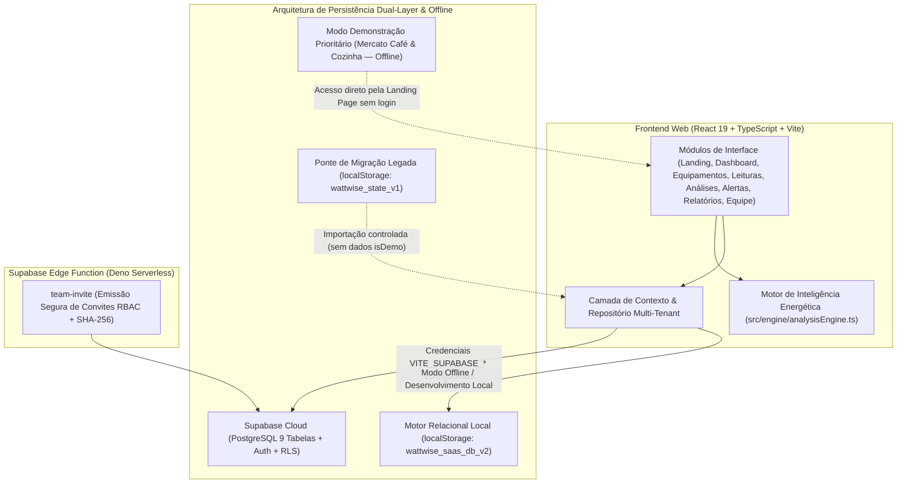
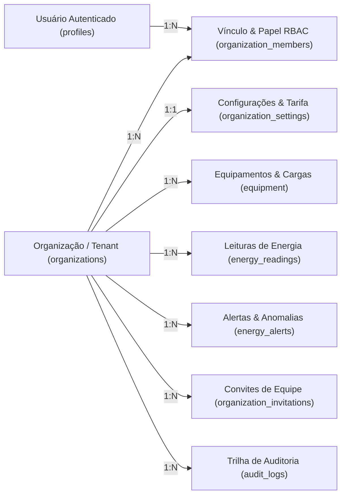

# Arquitetura do Sistema — WattWise

Este documento descreve a arquitetura de software do **WattWise — Smart Energy Intelligence**, plataforma SaaS web desenvolvida para evento escolar com foco em **tecnologia, eficiência energética, sustentabilidade e inteligência computacional**.

Todo o sistema é **100% operacional com registros inseridos pelo usuário**, sem dependência de hardware externo nem de APIs de IA de terceiros, combinando isolamento multi-tenant, persistência dual-layer (Supabase Cloud + Motor Relacional Local offline), Modo Demonstração prioritário e um motor analítico determinístico em [src/engine/analysisEngine.ts](file:///c:/antigravity%20sites/WattWise/src/engine/analysisEngine.ts).

---

## 1. Visão Geral da Arquitetura

O WattWise foi estruturado como uma Single-Page Application (SPA) modular em **React 19 + TypeScript**, com o motor de inteligência energética completamente desacoplado da camada de interface e de persistência.

---

## 2. Modelo de Isolamento Multi-Tenant (9 Tabelas)

No WattWise, a unidade central de organização e governança dos dados é a **Organização (`organizations`)**. Nenhum dado operacional (equipamento, leitura, alerta ou configuração) pertence diretamente a um usuário isolado; todo registro operacional pertence obrigatoriamente a um `organization_id`.

### Hierarquia de Domínio Multi-Tenant

### Princípios de Isolamento
1. **Chave Estrangeira Obrigatória (`organization_id`)**: Todas as tabelas operacionais possuem `organization_id UUID NOT NULL REFERENCES public.organizations(id) ON DELETE CASCADE`.
2. **Contexto Ativo Único**: O frontend mantém a organização ativa selecionada e escopa todas as consultas e mutações por `organization_id`.
3. **Validação no Banco de Dados (RLS)**: As políticas de Row Level Security (RLS) no PostgreSQL verificam o papel do `auth.uid()` na tabela `organization_members` antes de autorizar qualquer operação (`SELECT`, `INSERT`, `UPDATE`, `DELETE`).
4. **Rastreabilidade (`audit_logs`)**: Ações relevantes (criação/exclusão de equipamentos, alteração de tarifa ou limiar, reconhecimento/resolução de alertas, envio de convites e gestão de membros) são registradas na trilha de auditoria vinculada ao `organization_id` e ao `actor_user_id`.

---

## 3. Persistência Dual-Layer, Modo Demonstração e Migração Legada

Para funcionar com confiabilidade tanto em nuvem quanto em apresentações presenciais sem garantia de internet estável, o WattWise coordena quatro camadas de estado:

### 3.1. Modo Demonstração Prioritário (Acesso Direto e Offline)
- Acessível diretamente a partir da **Landing Page sem exigir cadastro ou login**, operando 100% offline no navegador.
- Carrega a organização fictícia **`Mercato Café & Cozinha`** (`src/data/demoData.ts`), composta por:
  - **8 equipamentos** (7 ativos e 1 compressor reserva inativo) com potências, quantidades e horas de uso realistas.
  - **16 dias de histórico de consumo** (`kWh`), incluindo **2 anomalias simuladas** (`71,4 kWh` e `66,8 kWh`) para demonstrar o motor analítico em ação.
  - Recomendações automáticas, projeção mensal e estimativa de impacto ambiental em `kg CO₂e`.
- Todos os registros de demonstração são marcados explicitamente com `isDemo: true` e `measurementType: 'simulated'`, jamais contaminando organizações reais.
- Um banner global persistente sinaliza o modo demonstrativo e disponibiliza um **botão para restaurar o ambiente** ao estado original em um clique.

### 3.2. Camada Cloud: Supabase (`@supabase/supabase-js`)
Quando `VITE_SUPABASE_URL` e `VITE_SUPABASE_ANON_KEY` estão configuradas:
- A autenticação utiliza **Supabase Auth** (JWT assinado com sessão persistida e refresh automático).
- Os dados são persistidos no **PostgreSQL** (9 tabelas) sob proteção de **Row Level Security (RLS)**.
- A Edge Function **`team-invite`** valida a permissão RBAC (`owner` ou `admin`), gera o token criptográfico SHA-256 em `organization_invitations` e registra o evento em `audit_logs`.

### 3.3. Camada Local: Motor Relacional Offline (`wattwise_saas_db_v2`)
Quando executado sem variáveis do Supabase (ou em ambiente local/testes automatizados):
- O WattWise opera com um repositório relacional multi-tenant sincronizado com a chave `wattwise_saas_db_v2` do `localStorage`.
- Reproduz a estrutura das entidades principais (`organizations`, `organization_members`, `organization_invitations`, `equipment`, `energy_readings`, `organization_settings`, `energy_alerts`, `audit_logs`) e aplica as mesmas regras de RBAC (`owner`, `admin`, `operator`, `viewer`).

### 3.4. Ponte de Migração Legada (`wattwise_state_v1`)
- Detecta de forma não invasiva dados salvos na chave `wattwise_state_v1` (versão anterior single-tenant).
- Filtra automaticamente qualquer registro marcado com `isDemo: true`, importando apenas equipamentos, leituras e configurações reais do usuário para a organização multi-tenant ativa.

---

## 4. Motor de Inteligência Energética (`src/engine/analysisEngine.ts`)

O motor analítico em [src/engine/analysisEngine.ts](file:///c:/antigravity%20sites/WattWise/src/engine/analysisEngine.ts) é escrito em **TypeScript puro e determinístico**, sem chamadas a APIs externas de IA e sem efeitos colaterais. Isso garante transparência matemática, latência zero no navegador e reprodutibilidade integral nos testes unitários com Vitest.

### 4.1. Separação Rigorosa: Potência, Energia Estimada e Energia Registrada

1. **Potência Nominal Instalada ($\text{W}$ / $\text{kW}$)**
   Representa a demanda elétrica instantânea dos equipamentos ativos:
   $$P_{\text{total\_ativa}} = \sum_{i \in \text{Ativos}} \left( P_{\text{unitário}, i} \times \text{Quantidade}_i \right)$$
   - Equipamentos com `status = 'inactive'` são separados em `inactiveInstalledPowerWatts` e não distorcem o rateio de carga ativa por categoria.

2. **Consumo Estimado por Equipamento ($\text{kWh}$)**
   Projeção teórica baseada na potência nominal ($W$), nas horas médias de uso diário ($h$) e na quantidade ($qtd$):
   $$\text{kWh}_{\text{estimado/dia}} = \frac{W \times h \times qtd}{1000}$$
   $$\text{kWh}_{\text{estimado/mês}} = \text{kWh}_{\text{estimado/dia}} \times 30$$

3. **Consumo Registrado ($\text{kWh}$)**
   Valor diário registrado pelo usuário ($C_t$) via:
   - **Consumo diário direto** ($\text{kWh}$); ou
   - **Leitura cumulativa do medidor** ($\text{kWh}_t = M_t - M_{t-1}$, validando $M_t \ge M_{t-1}$).
   - Cada registro mantém rastreabilidade via `measurement_type`:
     - `measured`: leitura real feita no medidor ou conta de energia.
     - `estimated`: estimativa operacional inserida pelo usuário quando não houve leitura direta.
     - `simulated`: dado demonstrativo ou de simulação (como o conjunto `Mercato Café & Cozinha`).

---

### 4.2. Detecção de Anomalias por Linha de Base Móvel (Rolling Baseline)

Em vez de depender de uma média fixa estática, o motor compara cada dia cronológico $t$ (a partir do 4º registro) com a **janela móvel dos dias imediatamente anteriores**:

- **Constantes do Motor**:
  - `MIN_BASELINE_DAYS_FOR_ANOMALY = 3`
  - `MIN_RECORDS_FOR_ANOMALIES = 4`
  - `ROLLING_BASELINE_WINDOW = 7`

Para o registro no índice cronológico $i \ge 3$, a linha de base móvel $\bar{B}_i$ é:
$$\bar{B}_i = \frac{1}{|W_i|} \sum_{j \in W_i} C_j \quad \text{onde } W_i = \{\max(0, i - 7), \dots, i - 1\}$$

O desvio percentual $\Delta_i$ em relação à linha de base é:
$$\Delta_i (\%) = \left( \frac{C_i - \bar{B}_i}{\bar{B}_i} \right) \times 100$$

Uma **anomalia** é detectada quando $\Delta_i \ge L_{\text{anomalia}}$ (onde $L_{\text{anomalia}}$ é o limiar configurado pela organização, padrão `20%`):
- **Severidade `warning` (Atenção)**: $L_{\text{anomalia}} \le \Delta_i < 1{,}5 \times L_{\text{anomalia}}$
- **Severidade `critical` (Crítico)**: $\Delta_i \ge 1{,}5 \times L_{\text{anomalia}}$
- **Excedente Financeiro Estimado (`R$`)**:
  $$\text{Excedente (kWh)} = C_i - \bar{B}_i \implies \text{Custo Excedente (R\$)} = \text{Excedente (kWh)} \times \text{Tarifa (R\$/kWh)}$$

---

### 4.3. Previsão Mensal e Grau de Confiança

O motor projeta o fechamento mensal de energia e custo financeiro usando os últimos `FORECAST_WINDOW_DAYS = 30` registros:

- **Mínimo Obrigatório (`MIN_RECORDS_FOR_FORECAST = 3`)**: evita projeções distorcidas com apenas 1 ou 2 dias.
- **Fórmula de Projeção (30 dias)**:
  $$\text{Previsão Mensal (kWh)} = \left( \frac{1}{|W_{30}|} \sum_{r \in W_{30}} C_r \right) \times 30$$
  $$\text{Custo Mensal Estimado (R\$)} = \text{Previsão Mensal (kWh)} \times \text{Tarifa (R\$/kWh)}$$
- **Grau de Confiança**:
  - **Insuficiente (`< 3 dias`)**: projeção bloqueada com aviso claro de quantos registros faltam.
  - **Preliminar (`3 a 6 dias`)**: estimativa inicial habilitada.
  - **Moderada (`7 a 13 dias`)**: incorpora pelo menos um ciclo semanal completo.
  - **Alta (`>= 14 dias`)**: base estatística consistente com duas ou mais semanas de histórico.

---

### 4.4. Impacto Ambiental Estimado (`kg CO₂e` — Matriz Elétrica Brasileira / SIN)

Para conectar eficiência energética e sustentabilidade de forma compreensível e cientificamente fundamentada, o WattWise estima as emissões associadas ao consumo elétrico e ao potencial de economia utilizando o fator médio de emissão de referência da **matriz elétrica brasileira (Sistema Interligado Nacional — SIN)**:

$$\text{Fator de Emissão (SIN)} = 0{,}0817\text{ kg CO}_2\text{e / kWh}$$

$$\text{Emissões Estimadas (kg CO}_2\text{e)} = \text{Energia (kWh)} \times 0{,}0817$$

- Aplicado sobre o consumo acumulado, a projeção mensal e a meta de redução de 10%, permitindo visualizar quantos quilogramas de $\text{CO}_2$ equivalente podem ser evitados com ações de eficiência energética.
- O fator de referência é exibido de forma transparente na interface como estimativa baseada na matriz elétrica brasileira, sem prometer medições certificadas de inventário GEE.

---

### 4.5. Recomendações Baseadas em Evidências

O motor avalia regras determinísticas sobre o inventário e o histórico real da organização para gerar recomendações priorizadas:
1. **Histórico Insuficiente**: orienta o usuário quando há menos de 4 dias registrados.
2. **Inventário Sem Cargas Ativas**: sinaliza quando não há equipamentos ativos cadastrados.
3. **Investigação de Anomalia Recente**: cruza o pico mais recente com o equipamento ativo de maior potência instalada e quantifica o custo excedente em `R$`.
4. **Tendência de Alta Recente**: com $\ge 10$ registros, compara a média dos últimos 5 dias com os 5 dias anteriores e alerta aumentos $\ge 8\%$.
5. **Concentração em Climatização**: acionada quando `Climatização` representa $\ge 30\%$ da potência ativa instalada.
6. **Concentração em Maquinário ou Refrigeração**: acionada quando `Maquinário` ou `Refrigeração` concentra $\ge 30\%$ da potência ativa instalada.
7. **Meta de Eficiência de 10%**: calcula a economia mensal exata em `R$`, `kWh` e `kg CO₂e` evitados.
8. **Operação Estável**: confirma ausência de anomalias quando há base histórica suficiente.
9. **Monitoramento Inicial**: estado informativo quando o inventário já está estruturado e aguarda novas leituras.
