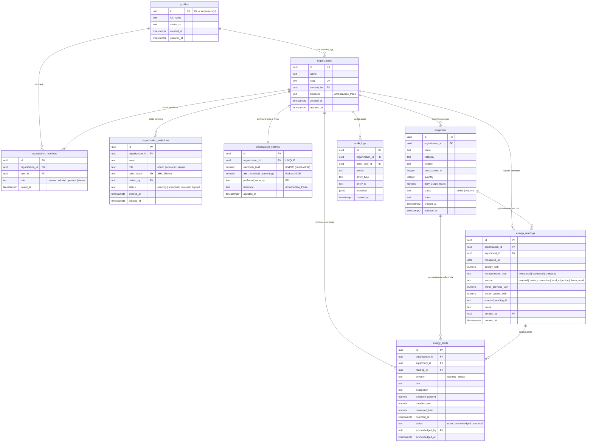

# Modelo de Banco de Dados & Schema — WattWise

Este documento detalha o modelo relacional multi-tenant enxuto do **WattWise** no PostgreSQL (Supabase), composto por **9 tabelas** essenciais para autenticação, isolamento por organização, inventário de equipamentos, registros manuais/cumulativos de consumo, alertas de anomalia e auditoria.

---

## 1. Diagrama Entidade-Relacionamento (Mermaid ERD)

---

## 2. Dicionário Completo das 9 Tabelas

### 2.1. `profiles`
Armazena os metadados públicos dos usuários autenticados via `auth.users` do Supabase Auth.
- **Chave Primária**: `id UUID PRIMARY KEY REFERENCES auth.users(id) ON DELETE CASCADE`
- **Colunas Principais**:
  - `full_name TEXT NOT NULL DEFAULT ''`
  - `avatar_url TEXT`
  - `created_at TIMESTAMPTZ NOT NULL DEFAULT now()`
  - `updated_at TIMESTAMPTZ NOT NULL DEFAULT now()`
- **Automação**: Populada automaticamente via trigger `on_auth_user_created` (`public.handle_new_auth_user()`) sempre que um novo usuário cria conta no Supabase Auth.

### 2.2. `organizations`
Entidade raiz do modelo multi-tenant, representando uma empresa, escola, laboratório ou unidade monitorada.
- **Chave Primária**: `id UUID PRIMARY KEY DEFAULT gen_random_uuid()`
- **Colunas Principais**:
  - `name TEXT NOT NULL CHECK (char_length(trim(name)) >= 2)`
  - `slug TEXT NOT NULL UNIQUE CHECK (slug ~ '^[a-z0-9]+(?:-[a-z0-9]+)*$')`
  - `created_by UUID REFERENCES auth.users(id) ON DELETE SET NULL`
  - `timezone TEXT NOT NULL DEFAULT 'America/Sao_Paulo'`
  - `created_at`, `updated_at`

### 2.3. `organization_members`
Tabela associativa que vincula usuários às organizações e define o papel RBAC.
- **Chave Primária**: `id UUID PRIMARY KEY DEFAULT gen_random_uuid()`
- **Restrição de Unicidade**: `UNIQUE (organization_id, user_id)`
- **Papéis Permitidos (`role`)**:
  - `'owner'`: Controle total da organização, gestão de administradores e exclusão do tenant.
  - `'admin'`: Gestão de membros (`operator`/`viewer`), convites, configurações tarifárias, equipamentos, leituras e alertas.
  - `'operator'`: Operação diária (cadastro/edição de equipamentos, registro de leituras e reconhecimento/resolução de alertas).
  - `'viewer'`: Acesso somente leitura a dashboards, inventário, histórico e exportação de relatórios.

### 2.4. `organization_invitations`
Gerencia convites emitidos pela Edge Function `team-invite` para adicionar colaboradores a uma organização.
- **Chave Primária**: `id UUID PRIMARY KEY DEFAULT gen_random_uuid()`
- **Colunas Principais**:
  - `organization_id UUID NOT NULL REFERENCES public.organizations(id) ON DELETE CASCADE`
  - `email TEXT NOT NULL CHECK (position('@' in email) > 1)`
  - `role TEXT NOT NULL CHECK (role IN ('admin', 'operator', 'viewer'))`
  - `token_hash TEXT NOT NULL UNIQUE` (Hash SHA-256 em hexadecimal do token de convite; o token puro não é salvo no banco)
  - `invited_by UUID REFERENCES auth.users(id) ON DELETE SET NULL`
  - `status TEXT NOT NULL DEFAULT 'pending' CHECK (status IN ('pending', 'accepted', 'revoked', 'expired'))`
  - `expires_at TIMESTAMPTZ NOT NULL`
  - `created_at TIMESTAMPTZ NOT NULL DEFAULT now()`

### 2.5. `equipment`
Inventário de equipamentos e cargas elétricas cadastrados na organização.
- **Chave Primária**: `id UUID PRIMARY KEY DEFAULT gen_random_uuid()`
- **Colunas Principais**:
  - `organization_id UUID NOT NULL REFERENCES public.organizations(id) ON DELETE CASCADE`
  - `name TEXT NOT NULL CHECK (char_length(trim(name)) >= 1)` (ex.: *Forno Elétrico Combinado 6 Bandejas*)
  - `category TEXT NOT NULL` (*Climatização*, *Iluminação*, *Refrigeração*, *Maquinário*, *TI e Escritório*, *Outros*)
  - `location TEXT NOT NULL DEFAULT 'Principal'` (Setor físico, ex.: *Cozinha de Produção*, *Salão de Atendimento*)
  - `rated_power_w INTEGER NOT NULL CHECK (rated_power_w > 0)` (Potência nominal unitária em Watts)
  - `quantity INTEGER NOT NULL DEFAULT 1 CHECK (quantity > 0)`
  - `daily_usage_hours NUMERIC(4,2) NOT NULL DEFAULT 8.0 CHECK (daily_usage_hours >= 0 AND daily_usage_hours <= 24)`
  - `status TEXT NOT NULL DEFAULT 'active' CHECK (status IN ('active', 'inactive'))`
  - `notes TEXT`
  - `created_at`, `updated_at`

### 2.6. `energy_readings`
Série temporal de registros de consumo de energia elétrica (`kWh`) inseridos pelo usuário.
- **Chave Primária**: `id UUID PRIMARY KEY DEFAULT gen_random_uuid()`
- **Colunas Principais**:
  - `organization_id UUID NOT NULL REFERENCES public.organizations(id) ON DELETE CASCADE`
  - `equipment_id UUID REFERENCES public.equipment(id) ON DELETE SET NULL` (Opcional, para associar a leitura a um equipamento específico)
  - `measured_at DATE NOT NULL` (Data da leitura)
  - `energy_kwh NUMERIC(12,3) NOT NULL CHECK (energy_kwh >= 0)` (Consumo efetivo do período em kWh)
  - `measurement_type TEXT NOT NULL CHECK (measurement_type IN ('measured', 'estimated', 'simulated'))`
  - `source TEXT NOT NULL DEFAULT 'manual' CHECK (source IN ('manual', 'meter_cumulative', 'local_migration', 'demo_seed'))`
  - `meter_previous_kwh NUMERIC(14,3)` (Leitura anterior do relógio medidor quando `source = 'meter_cumulative'`)
  - `meter_current_kwh NUMERIC(14,3)` (Leitura atual do relógio medidor, com constraint `meter_current_kwh >= meter_previous_kwh`)
  - `external_reading_id TEXT` (Identificador opcional para evitar duplicidade em importações)
  - `notes TEXT`
  - `created_by UUID REFERENCES auth.users(id) ON DELETE SET NULL`
  - `created_at TIMESTAMPTZ NOT NULL DEFAULT now()`

### 2.7. `organization_settings`
Parâmetros tarifários e sensibilidade analítica de cada organização (relação `1:1` com `organizations`).
- **Chave Primária**: `id UUID PRIMARY KEY DEFAULT gen_random_uuid()`
- **Restrição**: `organization_id UUID NOT NULL UNIQUE REFERENCES public.organizations(id) ON DELETE CASCADE`
- **Colunas Principais**:
  - `electricity_tariff NUMERIC(10,4) NOT NULL DEFAULT 0.92 CHECK (electricity_tariff > 0)` (Tarifa em `R$/kWh`)
  - `alert_threshold_percentage NUMERIC(6,2) NOT NULL DEFAULT 20.0 CHECK (alert_threshold_percentage >= 5 AND alert_threshold_percentage <= 200)` (Limiar percentual de desvio para disparo de anomalia)
  - `preferred_currency TEXT NOT NULL DEFAULT 'BRL'`
  - `timezone TEXT NOT NULL DEFAULT 'America/Sao_Paulo'`
  - `updated_at TIMESTAMPTZ NOT NULL DEFAULT now()`

### 2.8. `energy_alerts`
Alertas de anomalia detectados quando o consumo excede a linha de base móvel configurada.
- **Chave Primária**: `id UUID PRIMARY KEY DEFAULT gen_random_uuid()`
- **Colunas Principais**:
  - `organization_id UUID NOT NULL REFERENCES public.organizations(id) ON DELETE CASCADE`
  - `equipment_id UUID REFERENCES public.equipment(id) ON DELETE SET NULL`
  - `reading_id UUID REFERENCES public.energy_readings(id) ON DELETE CASCADE`
  - `severity TEXT NOT NULL CHECK (severity IN ('warning', 'critical'))`
  - `title TEXT NOT NULL`, `description TEXT NOT NULL`
  - `deviation_percent NUMERIC(7,2)`
  - `baseline_kwh NUMERIC(12,3)`, `measured_kwh NUMERIC(12,3)`
  - `detected_at TIMESTAMPTZ NOT NULL DEFAULT now()`
  - `status TEXT NOT NULL DEFAULT 'open' CHECK (status IN ('open', 'acknowledged', 'resolved'))`
  - `acknowledged_by UUID REFERENCES auth.users(id) ON DELETE SET NULL`
  - `acknowledged_at TIMESTAMPTZ`

### 2.9. `audit_logs`
Trilha imutável (append-only) de eventos operacionais e de segurança por organização.
- **Chave Primária**: `id UUID PRIMARY KEY DEFAULT gen_random_uuid()`
- **Colunas Principais**:
  - `organization_id UUID NOT NULL REFERENCES public.organizations(id) ON DELETE CASCADE`
  - `actor_user_id UUID REFERENCES auth.users(id) ON DELETE SET NULL`
  - `action TEXT NOT NULL` (ex.: `'organization.created'`, `'equipment.created'`, `'reading.recorded'`, `'alert.resolved'`, `'invitation.created'`)
  - `entity_type TEXT NOT NULL`
  - `entity_id TEXT`
  - `metadata JSONB NOT NULL DEFAULT '{}'::jsonb`
  - `created_at TIMESTAMPTZ NOT NULL DEFAULT now()`

---

## 3. Semântica de `measurement_type`

A coluna `measurement_type` em `energy_readings` assegura honestidade analítica sobre a origem de cada registro:

| Valor | Origem | Uso Recomendado |
| :--- | :--- | :--- |
| `'measured'` | Leitura real obtida no medidor da concessionária, submedidor interno ou fatura diária/periódica. | Padrão para acompanhamento oficial de consumo, auditoria de conta de luz e detecção primária de anomalias. |
| `'estimated'` | Valor estimado manualmente pelo usuário quando não foi possível consultar o medidor físico naquele dia. | Preenchimento pontual de lacunas mantendo rastreabilidade clara nos relatórios. |
| `'simulated'` | Registro demonstrativo (como o conjunto `Mercato Café & Cozinha`) ou simulação educativa de pico de consumo. | Demonstrações presenciais, testes do motor de anomalias e exploração sem confundir com medições reais. |

---

## 4. Índices e Restrições de Integridade

O schema define índices B-Tree compostos orientados ao isolamento por `organization_id` e séries temporais:

- `idx_org_members_org_id` em `organization_members (organization_id)` — Acelera listagem de membros por organização.
- `idx_org_members_user_org` em `organization_members (user_id, organization_id)` — Acelera verificações de RLS e listagem de organizações do usuário autenticado.
- `idx_org_invitations_org_id` em `organization_invitations (organization_id, status)` — Consulta rápida de convites pendentes.
- `idx_equipment_org_id` em `equipment (organization_id, status)` — Otimiza o cálculo de potência ativa instalada.
- `idx_energy_readings_org_measured_at` em `energy_readings (organization_id, measured_at DESC)` — Índice primário para gráficos, janela móvel de 7 dias e relatórios.
- `idx_energy_readings_equipment_id` em `energy_readings (equipment_id, measured_at DESC)` — Consultas filtradas por equipamento.
- `idx_energy_readings_org_external_id` em `energy_readings (organization_id, external_reading_id) WHERE external_reading_id IS NOT NULL` — Previne duplicação em importações.
- `idx_energy_alerts_org_status` em `energy_alerts (organization_id, status, detected_at DESC)` — Alimenta o painel de alertas abertos e reconhecidos.
- `idx_audit_logs_org_created_at` em `audit_logs (organization_id, created_at DESC)` — Paginação cronológica da trilha de auditoria.

---

## 5. Ordem de Execução das Migrações SQL

As migrações SQL localizadas em `supabase/migrations/` devem ser aplicadas em ordem cronológica:

1. **`20261122000001_initial_saas_schema.sql`**
   - Habilita a extensão `pgcrypto`, cria as 9 tabelas do schema `public`, define constraints `CHECK`, chaves estrangeiras, índices de performance e os triggers de `updated_at` e criação automática de perfil (`handle_new_auth_user`).
2. **`20261122000002_rls_and_security_policies.sql`**
   - Habilita `ALTER TABLE ... ENABLE ROW LEVEL SECURITY` em todas as 9 tabelas do schema `public`.
   - Cria as funções auxiliares `SECURITY DEFINER` com `SET search_path = public` (`get_user_org_role`, `user_has_org_role`, `create_organization_with_owner`).
   - Aplica as políticas granulares de `SELECT`, `INSERT`, `UPDATE` e `DELETE` conforme a matriz RBAC (`owner`, `admin`, `operator`, `viewer`).
